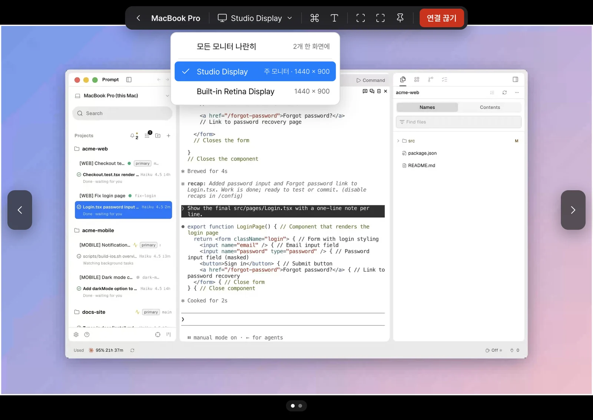
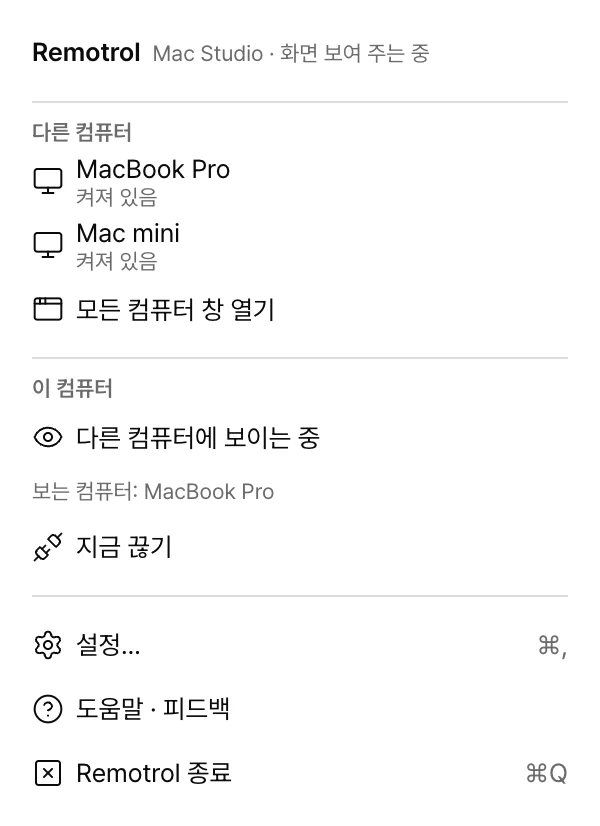
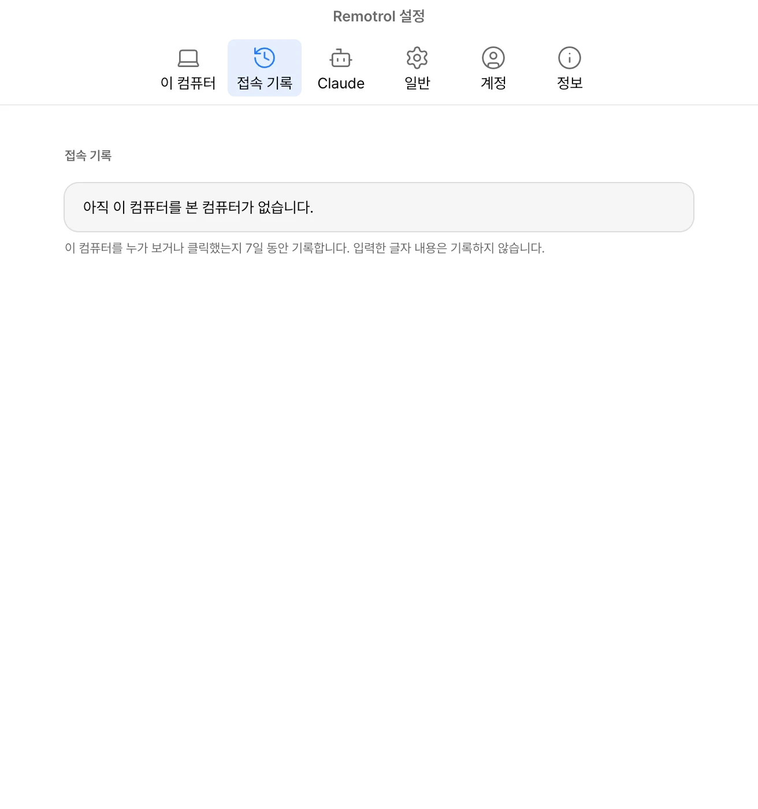
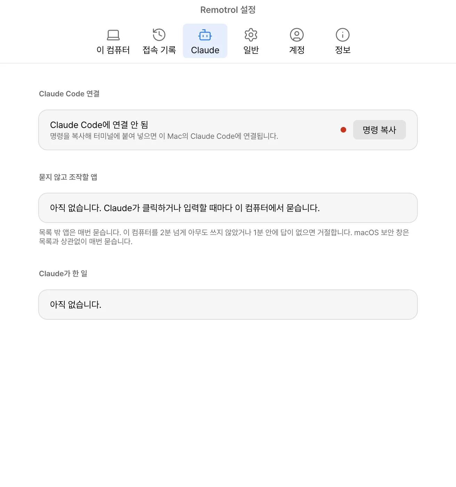
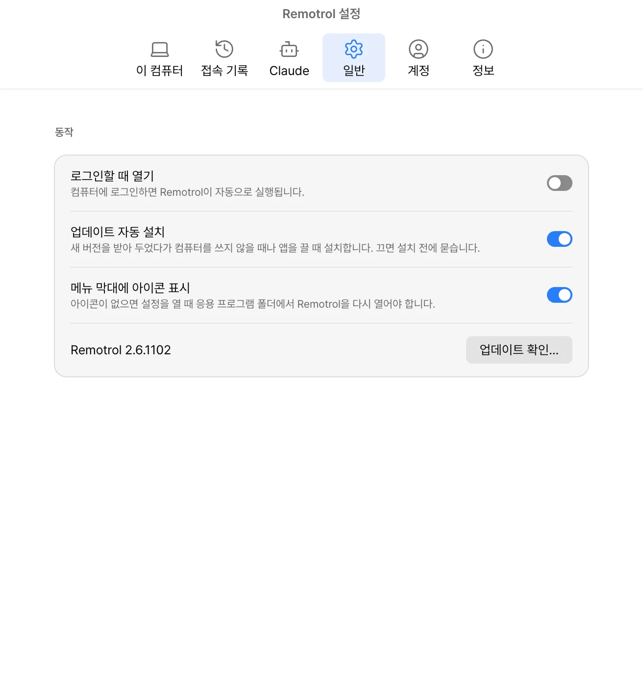

<p align="center">
  
</p>
<h1 align="center">Remotrol</h1>
<p align="center"><b>옆자리 컴퓨터를 내 자리에서.</b><br>같은 RUNNERS 계정의 다른 컴퓨터 화면을 모니터별로 보고, 클릭하고 글자를 칩니다.</p>
<p align="center">
  <a href="https://runners.im/remotrol"><b>Mac 용 받기</b></a> ·
  <a href="https://runners.im/remotrol">runners.im/remotrol</a> ·
  <a href="README.md">English</a>
</p>
<p align="center"><sub>무료 · macOS 14 이상 · Apple silicon · Intel · iPhone 앱 준비 중 · 20개 언어</sub></p>

<picture>
  <source media="(prefers-color-scheme: dark)" srcset="docs/images/view-ko-dark.webp">
  
</picture>

## 하는 일

<table>
<tr>
<td width="50%"><picture><source media="(prefers-color-scheme: dark)" srcset="docs/images/menu-ko-dark.webp"></picture><br><b>메뉴 막대에 있습니다</b><br>아이콘이 이 맥이 꺼짐 · 대기 중 · 보는 중인지 보여 줍니다. 패널에서 다른 컴퓨터를 고르면 그 화면이 열립니다.</td>
<td width="50%"><picture><source media="(prefers-color-scheme: dark)" srcset="docs/images/log-ko-dark.webp"></picture><br><b>누가 봤는지 남습니다</b><br>컴퓨터 · 휴대폰 · Claude 가 이 맥을 보거나 클릭 · 입력한 기록을 7일 동안 남깁니다. 입력한 글자 내용은 남기지 않습니다.</td>
</tr>
<tr>
<td><picture><source media="(prefers-color-scheme: dark)" srcset="docs/images/claude-ko-dark.webp"></picture><br><b>Claude 도 같은 화면을 씁니다</b><br>MCP 도구 여섯 개로 Claude 가 컴퓨터 목록을 보고 화면을 보며, 사람이 허락하면 클릭하고 입력합니다.</td>
<td><picture><source media="(prefers-color-scheme: dark)" srcset="docs/images/general-ko-dark.webp"></picture><br><b>업데이트는 조용히</b><br>아무도 맥을 쓰지 않을 때나 앱을 끌 때 새 판을 깔고, 누가 보는 중이면 기다립니다.</td>
</tr>
</table>

같은 RUNNERS 계정으로 로그인한 컴퓨터끼리 서로 찾습니다. 따로 설정할 망이 없습니다. 화면 · 클릭 · 키 입력은 두 기기 사이를 암호화해 바로 오가고 서버를 거치지 않습니다.

## 설치

```sh
brew install --cask runners-im/tap/remote
```

또는 [Releases](https://github.com/RUNNERS-IM/remotrol/releases/latest) 에서 `remote-macos-arm64.dmg`(Apple silicon) · `remote-macos-x64.dmg`(Intel) 를 받습니다.

Remotrol 은 macOS 권한 두 개를 묻습니다. 다른 컴퓨터가 이 화면을 보려면 **화면 기록**, 클릭 · 입력하려면 **손쉬운 사용**이 필요합니다. **다른 컴퓨터에 이 화면 보이기**를 끄면 둘 다 한 번에 막힙니다.

## Claude 와 같이 쓰기

```sh
claude mcp add --scope user remote -- env ELECTRON_RUN_AS_NODE=1 /Applications/Remotrol.app/Contents/MacOS/Remotrol \
  /Applications/Remotrol.app/Contents/Resources/mcp/remote-mcp.mjs
```

설정의 **Claude** 탭에서 명령을 복사해 터미널에 붙여 넣어도 됩니다. Remotrol 이 켜져 있어야 합니다.

## 지우는 방법

메뉴 막대에서 Remotrol 을 끄고, 응용 프로그램 폴더에서 휴지통으로 옮긴 뒤, 시스템 설정 › 개인정보 보호 및 보안에서 권한을 지우거나 아래를 실행합니다.

```sh
tccutil reset ScreenCapture im.runners.remote
tccutil reset Accessibility im.runners.remote
```

## 개인정보

Remotrol 에는 광고와 사용 통계 수집이 없습니다. 오류가 나면 이메일 · 토큰 · 컴퓨터 이름을 지운 오류 보고를 Runners 의 오류 수집 서비스(Sentry)로 보냅니다. [PRIVACY.md](PRIVACY.md) 를 보세요.

## 개발

[docs/development.md](docs/development.md) 를 보세요(영어).

---

<p align="center"><a href="https://runners.im"><picture><source media="(prefers-color-scheme: dark)" srcset="https://runners.im/icons/logos/RUNNERS_H_W.svg"></picture></a><br><sub>RUNNERS 가 만듭니다 · 코드는 읽기용으로만 공개, <a href="LICENSE.md">LICENSE.md</a></sub></p>
