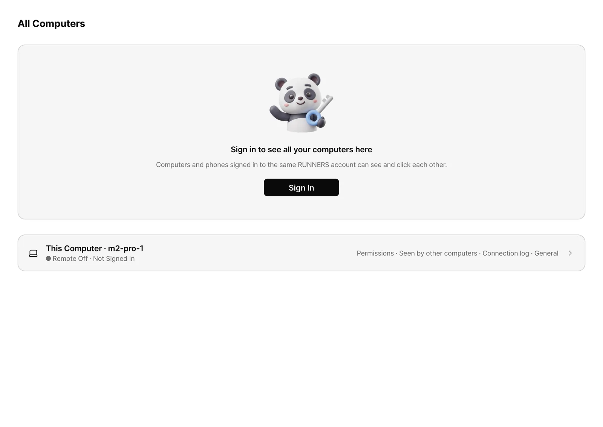
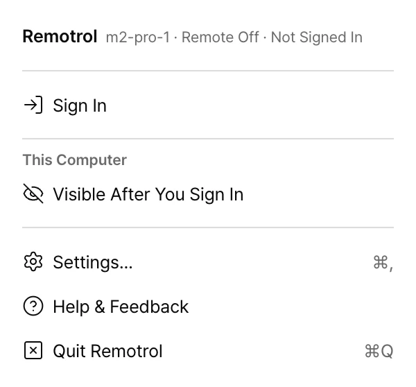
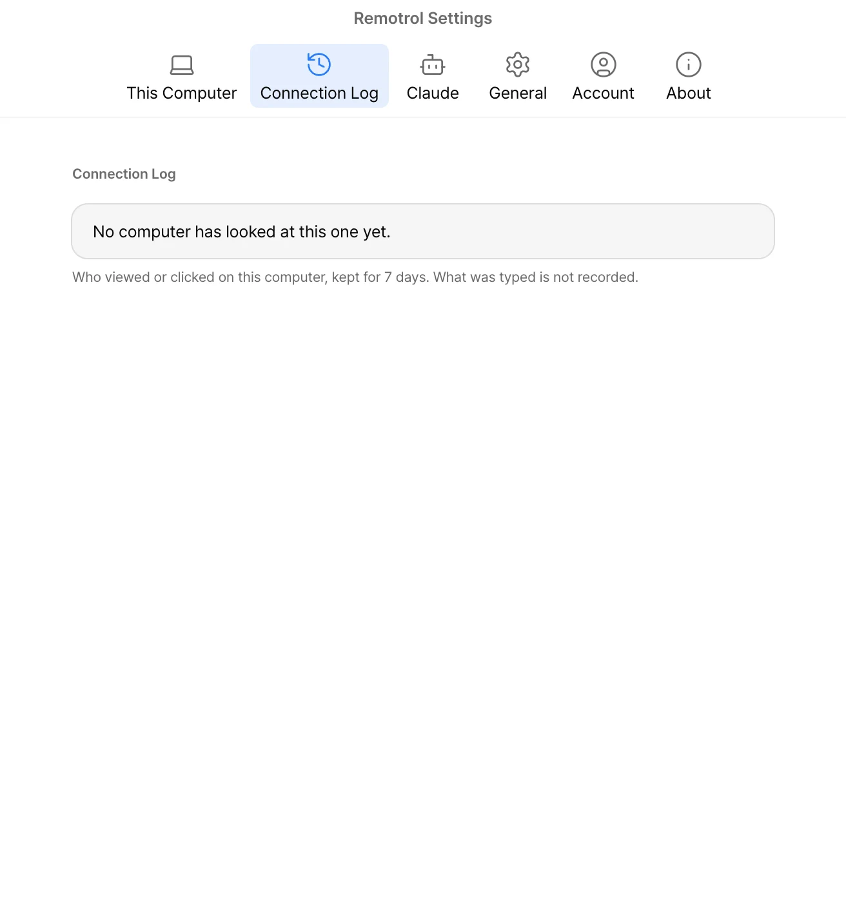
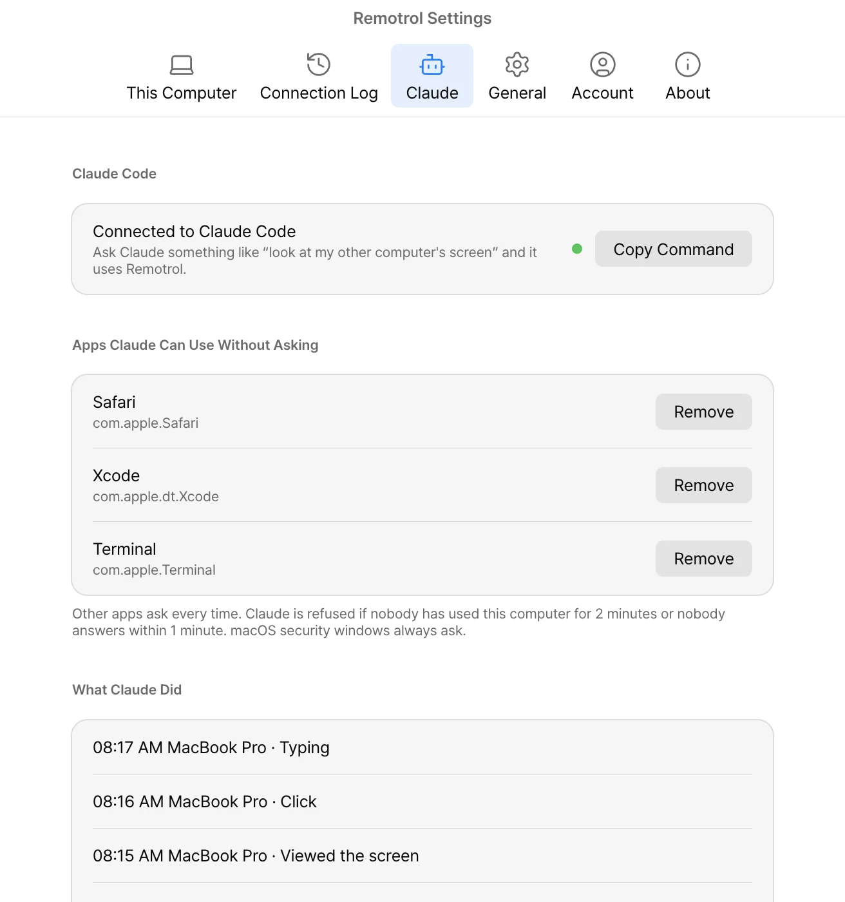
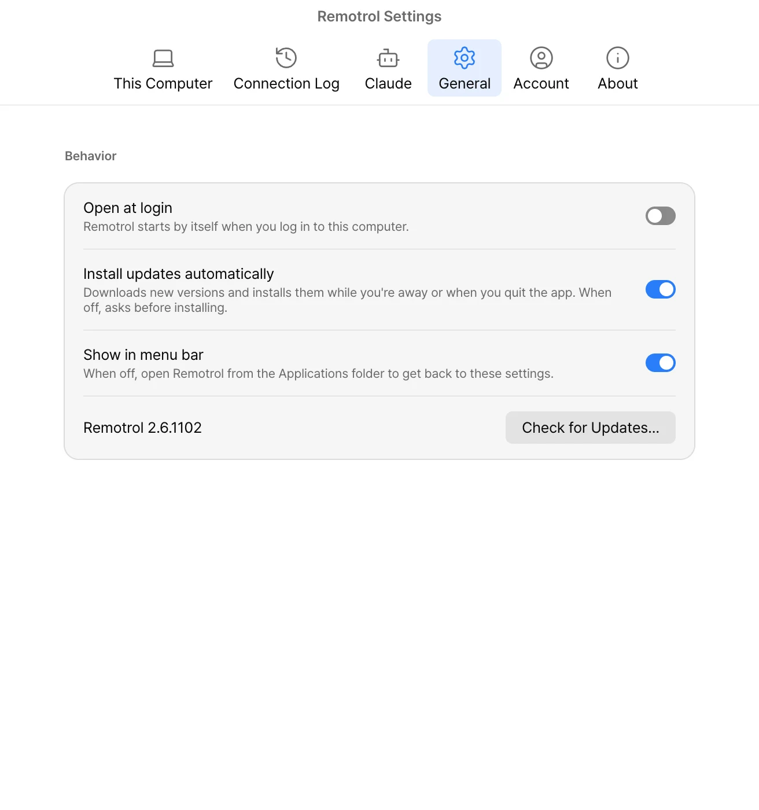

<p align="center">
  
</p>
<h1 align="center">Remotrol</h1>
<p align="center"><b>The computer next door, right from your desk.</b><br>See the other computers on your RUNNERS account, one monitor at a time, and click and type on them.</p>
<p align="center">
  <a href="https://runners.im/remote"><b>Download for Mac</b></a> ·
  <a href="https://runners.im/remote">runners.im/remote</a> ·
  <a href="README.ko.md">한국어</a>
</p>
<p align="center"><sub>Free · macOS 14 or later · Apple silicon · Intel · iPhone app coming · 20 languages</sub></p>

<picture>
  <source media="(prefers-color-scheme: dark)" srcset="docs/images/all-computers-en-dark.webp">
  
</picture>

## What it does

<table>
<tr>
<td width="50%"><picture><source media="(prefers-color-scheme: dark)" srcset="docs/images/menu-en-dark.webp"></picture><br><b>Lives in the menu bar</b><br>The icon shows whether this Mac is off, waiting or being viewed. Its panel lists your other computers; pick one to see its screens.</td>
<td width="50%"><picture><source media="(prefers-color-scheme: dark)" srcset="docs/images/log-en-dark.webp"></picture><br><b>See who looked</b><br>Who viewed, clicked or typed on this Mac, from a computer, a phone or Claude, kept for 7 days. What was typed is never recorded.</td>
</tr>
<tr>
<td><picture><source media="(prefers-color-scheme: dark)" srcset="docs/images/claude-en-dark.webp"></picture><br><b>Claude can use the same screens</b><br>Six MCP tools let Claude list the computers, see them, and click and type once a person approves.</td>
<td><picture><source media="(prefers-color-scheme: dark)" srcset="docs/images/general-en-dark.webp"></picture><br><b>Updates itself quietly</b><br>New versions install while nobody is using the Mac or when you quit, and wait while someone is watching.</td>
</tr>
</table>

Computers signed in to the same RUNNERS account find each other; there is no network to set up. Screens, clicks and keys go directly between the two devices, encrypted, and never through the server.

## Install

```sh
brew install --cask runners-im/tap/remote
```

Or download the latest `remote-macos-arm64.dmg` (Apple silicon) or `remote-macos-x64.dmg` (Intel) from [Releases](https://github.com/RUNNERS-IM/remotrol/releases/latest).

Remotrol asks for two macOS permissions: **Screen Recording**, so other computers can see this one, and **Accessibility**, so they can click and type on it. **Let Other Computers See This** turns both off at once.

## Using Remotrol with Claude

```sh
claude mcp add --scope user remote -- env ELECTRON_RUN_AS_NODE=1 /Applications/Remotrol.app/Contents/MacOS/Remotrol \
  /Applications/Remotrol.app/Contents/Resources/mcp/remote-mcp.mjs
```

Or copy the command from the **Claude** tab in Settings and paste it in Terminal. Remotrol must be running.

## Uninstall

Quit Remotrol from the menu bar, move it from Applications to the Trash, and remove its permissions in System Settings › Privacy & Security, or run:

```sh
tccutil reset ScreenCapture im.runners.remote
tccutil reset Accessibility im.runners.remote
```

## Privacy

Remotrol has no ads or analytics. When it hits an error, it sends a crash report to Runners' error tracker (Sentry) with emails, tokens and computer names removed first. See [PRIVACY.md](PRIVACY.md).

## Development

See [docs/development.md](docs/development.md).

---

<p align="center"><a href="https://runners.im"><picture><source media="(prefers-color-scheme: dark)" srcset="https://runners.im/icons/logos/RUNNERS_H_W.svg"></picture></a><br><sub>Made by RUNNERS · Source published for reading only, see <a href="LICENSE.md">LICENSE.md</a></sub></p>
